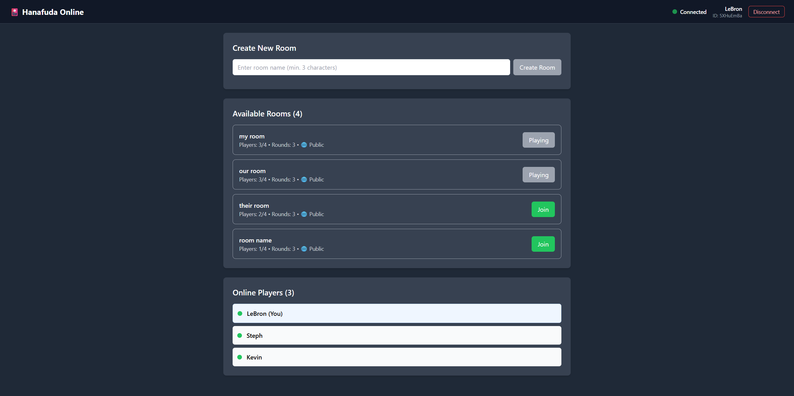
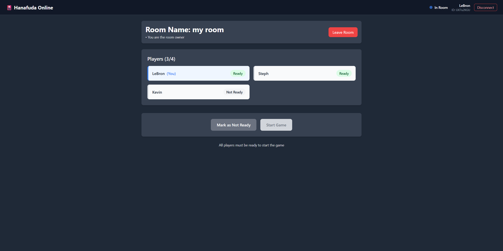
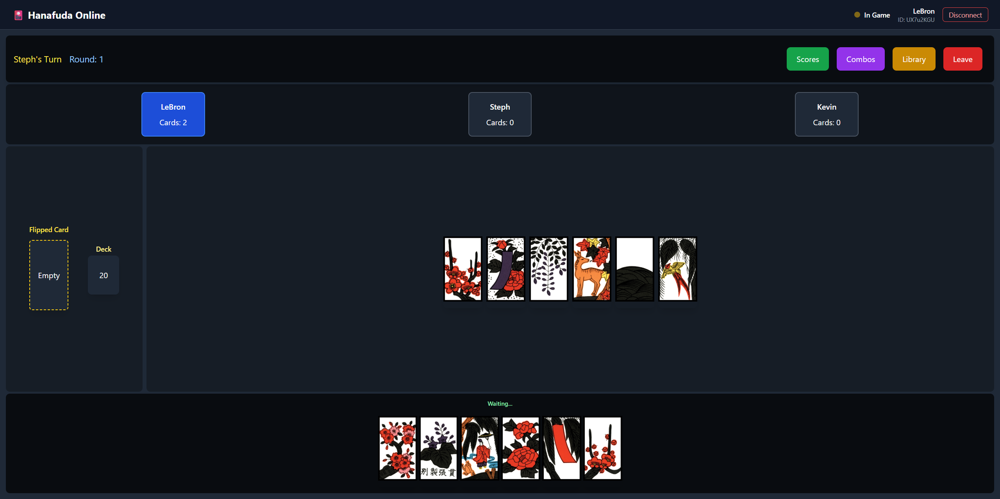
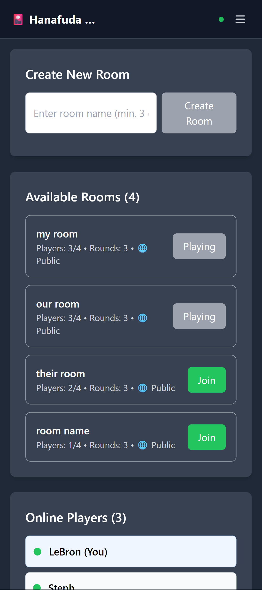
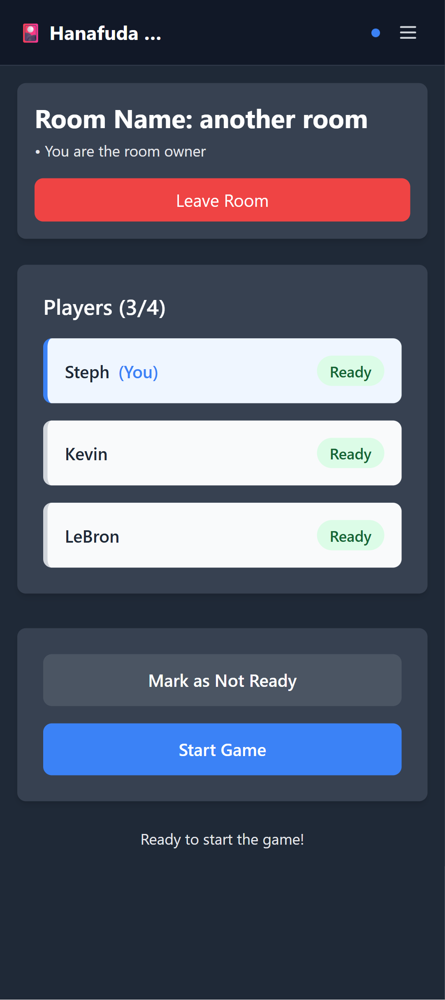
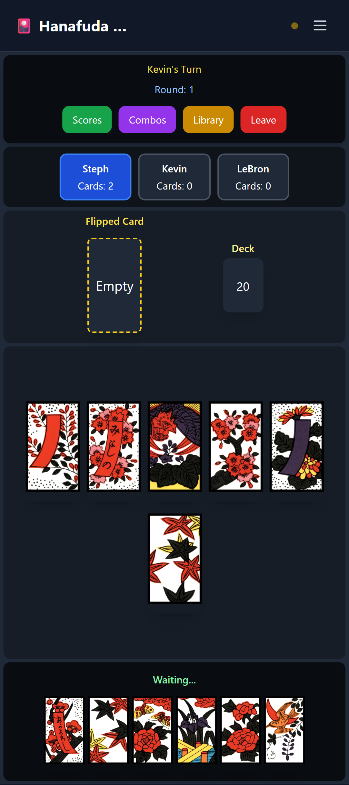
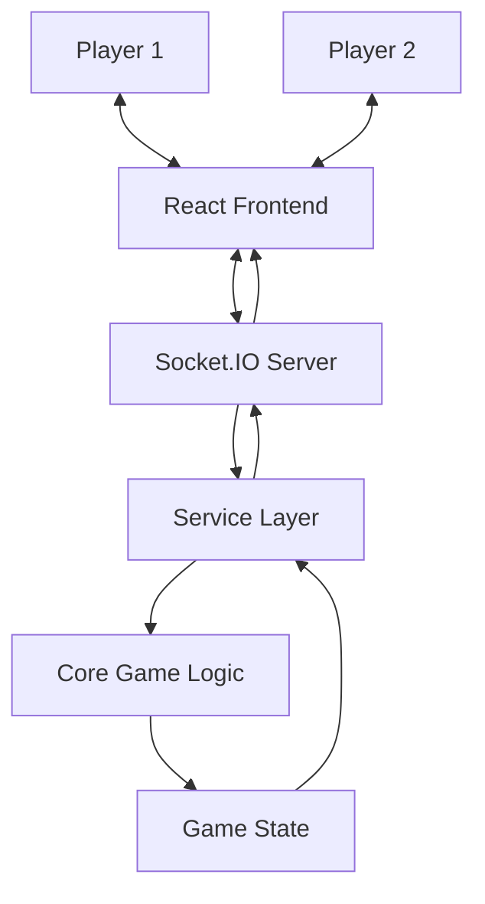

# 🎴 Hanafuda Online

A real-time multiplayer Hanafuda card game built with **React, TypeScript, Node.js, and Socket.IO**.

Hanafuda Online brings the traditional Japanese flower-card game to the web, allowing players to connect, create or join game rooms, and compete with others through real-time multiplayer gameplay.

## Screenshots

### Full Screen

<div align="center">
  <table>
    <tr>
      <td align="center">
        
        <br />
        <strong>Lobby</strong>
      </td>
      <td align="center">
        
        <br />
        <strong>Game Room</strong>
      </td>
      <td align="center">
        
        <br />
        <strong>Game Play</strong>
      </td>
    </tr>
  </table>
</div>

### Mobile Screen

<div align="center">
  <table>
    <tr>
      <td align="center">
        
        <br />
        <strong>Lobby</strong>
      </td>
      <td align="center">
        
        <br />
        <strong>Game Room</strong>
      </td>
      <td align="center">
        
        <br />
        <strong>Game Play</strong>
      </td>
    </tr>
  </table>
</div>

---

## Features

### Multiplayer System

- Real-time multiplayer gameplay powered by Socket.IO.
- Create and join game rooms.
- Browse available rooms.
- View online players.
- Synchronize game state between connected players.

### Game System

- Interactive Hanafuda card gameplay.
- Turn-based multiplayer mechanics.
- Card matching and capturing.
- Automatic card combination and score calculations.
- Round transitions and game result handling.
- Captured card tracking and player score displays.

### Game Information

- Hanafuda card library.
- Card combination reference.
- Combination scoring information.

### User Interface

- Responsive game interface.
- Interactive card selection.
- Player and game status indicators.
- Captured card and score modals.
- Dedicated lobby and room interfaces.

## Architecture

The project uses a client-server architecture.

- **Frontend:** Handles the user interface, navigation, lobby interactions, and presentation of game state.
- **Backend:** Manages game logic, players, rooms, sessions, and real-time communication.
- **Socket.IO:** Facilitates bidirectional communication between the frontend and backend.

### Communication Flow



### Backend Architecture

The backend follows a modular structure that separates responsibilities into different layers:

- **Core:** Game entities and fundamental game logic.
- **Services:** Application logic for managing games, lobbies, players, rooms, and sessions.
- **Interfaces:** TypeScript contracts for entities, services, socket communication, and data transfer objects.
- **Constants:** Static game data, including card combinations.
- **Utilities:** Shared functions for combination calculations and ID generation.

## Project Structure

```text
Hanafuda-Online-Game/
│
├── frontend/
|    └── hanafuda-web/
│        ├── src/
│        │   ├── assets/
│        │   ├── constants/
│        │   ├── contexts/
│        │   ├── pages/
│        │   │   ├── components/
│        │   │   └── lobby/
│        │   └── utils/
│        ├── App.jsx
│        ├── GameLayout.jsx
│        ├── index.css
│        ├── main.jsx
│        ├── package.json
│        └── README.md
│
├── backend/
│   └── game-server/
│       ├── src/
│       │   ├── constants/
│       │   ├── core/
│       │   ├── interfaces/
│       │   ├── services/
│       │   ├── utils/
│       │   └── index.ts
│       ├── package.json
│       ├── tsconfig.json
│       └── README.md
│
└── README.md
```

## Getting Started

To run the complete application locally, you'll need to start both the backend server and frontend development server.

### Prerequisites

- [Node.js](https://nodejs.org/) (Node.js 20.19+ or 22.12+ recommended for Vite 7)
- npm
- Git

### 1. Clone the Repository

```bash
git clone https://github.com/ron12341/Hanafuda-Online-Game.git
cd Hanafuda-Online-Game
```

### 2. Set Up the Backend

Navigate to the backend directory:

```bash
cd backend/game-server
```

Install dependencies:

```bash
npm install
```

Create a `.env` file:

```env
PORT=3000
```

Start the development server:

```bash
npm run dev
```

The backend will run at:

```text
http://localhost:3000
```

### 3. Set Up the Frontend

Open another terminal and navigate to the frontend directory:

```bash
cd frontend/hanafuda-web
```

Install dependencies:

```bash
npm install
```

Create a `.env` file:

```env
VITE_WEBSOCKET_URL=http://localhost:3000
```

Start the development server:

```bash
npm run dev
```

Vite will display the local development URL, typically:

```text
http://localhost:5173
```

Make sure both the frontend and backend servers are running during local development.

## Environment Variables

### Frontend

| Variable             | Description                   | Example                 |
| -------------------- | ----------------------------- | ----------------------- |
| `VITE_WEBSOCKET_URL` | Backend Socket.IO server URL. | `http://localhost:3000` |

### Backend

| Variable | Description                      | Default |
| -------- | -------------------------------- | ------- |
| `PORT`   | Port used by the backend server. | `3000`  |

**Note:** Never commit `.env` files containing private credentials or sensitive configuration.

## Documentation

For more detailed installation and development instructions, see:

- [Frontend Documentation](frontend/hanafuda-web/README.md)
- [Backend Documentation](backend/game-server/README.md)

**Developed as a full-stack portfolio project.**

Built with React, Node.js, TypeScript, and Socket.IO.
